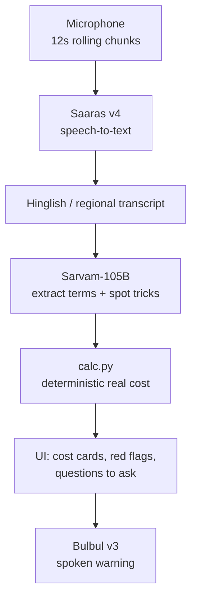

<div align="center">

# Teesra Kaan

### The third ear for the customer's side of the counter

Loan and insurance agents know the numbers. Customers usually don't.
Teesra Kaan listens to the pitch and tells you, in your own language, what it really costs and what to ask before you sign.

</div>

---

## Why Teesra Kaan

Most voice AI works for the institution. **Teesra Kaan** ("third ear") works for the person across the table.

A loan or insurance pitch is full of numbers that sound fine and hide the real price. The customer is expected to catch it all in real time, often in a second language, often under pressure to sign today.

> **Example:** ₹1 lakh for 24 months at "1.5% a month flat", with a 2% processing fee and ₹5,000 compulsory insurance, costs about **47.5% a year**, not the 18% it sounds like.

Teesra Kaan does that math for you while the agent is still talking.

### What you get

| Benefit                          | How                                                                                                                   |
| -------------------------------- | --------------------------------------------------------------------------------------------------------------------- |
| **Know the real price**          | The true yearly cost of a loan, or the real yearly return of a "guaranteed" policy, shown next to what the agent said |
| **Catch common tricks**          | Flags flat rates sold as monthly, fees deducted from your payout, "compulsory" insurance, pressure to sign today      |
| **Never lose the thread**        | A live transcript of the conversation, plus the terms that were actually said                                         |
| **Know what to say next**        | Short questions you can read out to the agent                                                                         |
| **Hear it in your own language** | Warnings in 11 languages, written in native script and spoken aloud                                                   |
| **Trust the numbers**            | All math is done in code, never by the AI model                                                                       |

### What agents say, and what it can mean

| What the agent says                    | What it can really mean                                                     |
| -------------------------------------- | --------------------------------------------------------------------------- |
| "Only 1.5% a month, flat rate"         | Interest on the full amount for the whole tenure, far above a reducing rate |
| "Insurance is compulsory"              | A bundled premium taken out of the money you actually receive               |
| "8% guaranteed return, better than FD" | A real yearly return that is often well below a bank FD                     |
| "Sign today, the offer ends tomorrow"  | Pressure that keeps you from reading the terms                              |

### Who it is for

- **Borrowers** comparing personal loan offers.
- **Policyholders** being sold savings or endowment-style insurance.
- **Family members** who want a second opinion in the room, in a language everyone understands.

---

## How it works

1. **Listen.** Press start and put the phone or laptop near the conversation. Audio is captured in 12-second chunks.
2. **Understand.** Each chunk is transcribed, then the AI extracts only the numbers that were said (amount, tenure, rate, fees, insurance) and spots unfair practices.
3. **Calculate.** A deterministic calculator turns those numbers into the real annual cost or real return.
4. **Warn.** The page shows the real cost, red flags and questions to ask, and can whisper the top warning back to you.



### Why the math is deterministic

The AI model only **extracts the numbers that were said**. It never computes rates or totals.

`calc.py` converts "1.5% a month flat" plus fees and bundled insurance into the true annual cost (an IRR on the cash the customer actually receives), and converts a "guaranteed" maturity amount into the real yearly return. Language models make arithmetic mistakes, and a financial warning cannot afford one.

---

## Features

- **Live listening** in 12-second rolling chunks, with the analysis updating as the conversation continues.
- **Code-mixed speech support** for Hinglish and regional-language speech.
- **Red-flag detection** for flat rates sold as monthly, fees deducted from the payout, bundled or "compulsory" insurance, "guaranteed" returns, pressure to sign, prepayment penalties and vague total cost.
- **Real cost view** with EMI, cash you actually get, total paid and extra paid, or real return against a bank FD benchmark.
- **Questions to ask** in short, speakable sentences.
- **Spoken warnings** with optional auto-whisper of the first high-severity flag.
- **11 languages:** Hindi, Marathi, Bengali, Tamil, Telugu, Kannada, Malayalam, Gujarati, Punjabi, Odia and English. Your choice is remembered between visits.
- **Demo mode** to analyze a sample or pasted transcript with no microphone and no speech credits.
- **Responsive, accessible UI** that works on phones and desktops, follows your light or dark theme, and supports keyboard and screen readers.

---

## Getting Started

### Prerequisites

- Python 3.10 or newer
- A [Sarvam API key](https://www.sarvam.ai/)
- Chrome or Edge (recommended for microphone access)

### Install

```bash
git clone https://github.com/nevilcp/teesrakaan.git
cd teesrakaan

python3 -m venv .venv && . .venv/bin/activate
pip install -r requirements.txt

cp .env.example .env     # then set SARVAM_API_KEY in .env
```

### Run

```bash
uvicorn app:app --reload --port 8000
```

Open **http://localhost:8000**. If the key is missing, the page shows a banner telling you what to fix.

> Browsers only allow microphone access on `localhost` or over HTTPS. To use the mic from a phone, deploy behind HTTPS. Demo mode works anywhere.

### Configuration

| Variable                | Required | Default | Purpose                                       |
| ----------------------- | -------- | ------- | --------------------------------------------- |
| `SARVAM_API_KEY`        | yes      |         | Sarvam API key                                |
| `RATE_LIMIT_PER_MINUTE` | no       | `40`    | API requests allowed per client IP per minute |
| `LOG_LEVEL`             | no       | `INFO`  | Python log level                              |

### Test

```bash
pip install -r requirements-dev.txt
ruff check . && ruff format --check .
pytest
```

---

## Usage

### Live mode

1. Choose the language for warnings in the top-right selector.
2. Press **Start listening** and place the device near the conversation.
3. The transcript and warnings update about every 12 seconds.
4. Press **Stop** to process the last chunk.
5. Press **Whisper warning** to hear the top warning, or leave auto-whisper on.

### Demo mode (no microphone)

1. Scroll to the **Demo mode** card.
2. Load **Sample: loan pitch** or **Sample: insurance pitch**, or paste your own conversation.
3. Press **Analyze text**.

---

## Tech Stack

| Layer    | Technology                                                |
| -------- | --------------------------------------------------------- |
| Speech   | Sarvam Saaras v4 (speech-to-text), Sarvam Bulbul v3 (TTS) |
| LLM      | Sarvam-105B                                               |
| Backend  | Python, FastAPI, Uvicorn, httpx                           |
| Frontend | Vanilla HTML, CSS and ES modules, no framework, no build  |

---

## API

| Method | Endpoint          | Description                                         |
| ------ | ----------------- | --------------------------------------------------- |
| `GET`  | `/api/health`     | Service status and whether an API key is configured |
| `POST` | `/api/transcribe` | Audio chunk to transcript                           |
| `POST` | `/api/analyze`    | Transcript to extracted terms, real cost and flags  |
| `POST` | `/api/speak`      | Text to spoken audio                                |

Every endpoint except `/api/health` is rate limited per client IP (HTTP 429 with `Retry-After`). Audio chunks are capped at 2 MB, transcripts at 30,000 characters and spoken text at 2,400 characters. The interactive API docs are disabled.

---

## Project Structure

```
teesrakaan/
├── app.py            # FastAPI routes, limits, security headers
├── ratelimit.py      # Per-client sliding-window rate limiter
├── sarvam.py         # Async client for the Sarvam APIs
├── analyzer.py       # Prompt, LLM extraction, merging of deterministic flags
├── calc.py           # Loan and insurance math
├── static/           # Frontend (vanilla HTML, CSS, ES modules)
│   ├── index.html
│   ├── favicon.svg
│   ├── css/styles.css
│   └── js/
│       ├── main.js       # Wiring, session state, analysis flow
│       ├── recorder.js   # Rolling microphone chunks
│       ├── api.js        # Backend calls
│       ├── render.js     # Cost, flags, questions, terms
│       ├── ui.js         # DOM helpers, toast, storage
│       └── samples.js    # Demo pitches
├── tests/            # pytest suite for the calculator, limits and API
├── Dockerfile
├── requirements.txt  # Pinned runtime dependencies
├── requirements-dev.txt
├── pyproject.toml    # ruff and pytest settings
├── .github/          # CI, image publishing, Dependabot
└── .env.example
```

---

## Deployment

The app is one stateless container: no database, one secret (`SARVAM_API_KEY`).

### CI and image publishing (GitHub Actions)

`.github/workflows/ci.yml` runs on every push and pull request: ruff, pytest, then a Docker build with a container smoke test. Pushes to `main` and `v*` tags also publish the image to GitHub Container Registry as `ghcr.io/nevilcp/teesrakaan` (tags `latest`, the commit SHA, and the version for tags). Dependabot keeps Python packages, the base image and the Actions up to date.

### Running the container

```bash
docker run -p 8000:8000 -e SARVAM_API_KEY=... ghcr.io/nevilcp/teesrakaan:latest
```

The server reads `$PORT` (default 8000), runs as a non-root user, and has a built-in health check on `/api/health`.

### Production checklist

- **HTTPS is required** for the microphone. Terminate TLS at the host's proxy. The app adds HSTS when it sees HTTPS.
- **Keep the container behind a trusted proxy.** The image sets `FORWARDED_ALLOW_IPS=*` so the rate limiter sees real client IPs. Never expose the container port directly to the internet, or clients could spoof their IP.
- **Store `SARVAM_API_KEY` in the host's secret manager**, not in the image or the repository.
- **Cap spend**: set a usage alert in the Sarvam dashboard and a maximum instance count on the host. The rate limiter is per process, so the real limit is `RATE_LIMIT_PER_MINUTE` times the number of instances.
- **Monitor** `/api/health` with an uptime check. Logs never contain audio or transcripts.
- **Rotate the key** if it is ever exposed.

## Privacy and limitations

- Audio chunks and transcripts are sent to the Sarvam API for transcription, analysis and speech. This app does not store them.
- The AI extracts terms from speech, so noisy audio or unclear numbers can produce incomplete results. Check the "What was said" card against what you heard.
- The real-cost figures are only as good as the extracted numbers. Treat them as a strong warning to ask questions, not as a final quote.

## Disclaimer

This is a hackathon prototype and **not financial advice**. Always read the written loan or policy documents before you sign.
