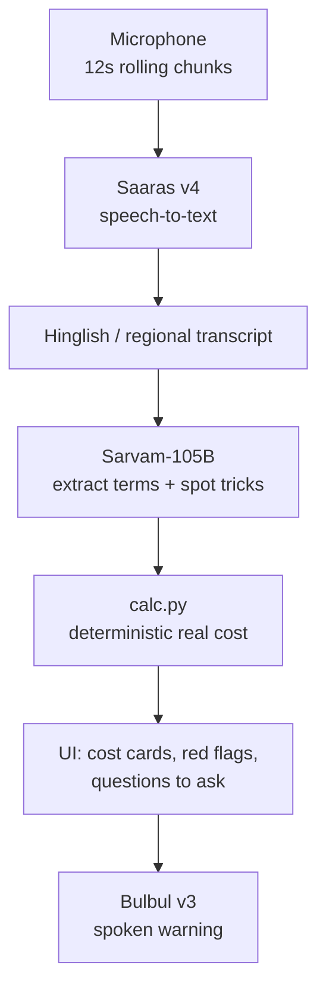

<div align="center">

# Teesra Kaan

### The third ear for the customer's side of the counter

A real-time voice assistant that listens to a loan or insurance pitch and warns the customer, in their own language, when something is off.


</div>

---

## Overview

Most voice AI works for the institution. **Teesra Kaan** ("third ear") works for the person across the table.

It listens to a conversation between a borrower or policyholder and an agent, extracts the terms that were actually spoken, computes the **true cost** with a deterministic calculator, and whispers the most important warning back in the customer's language.

**Built for the Sarvam Campus Connect session using the Sarvam API.**

### The problem

| What the agent says                    | What it can really mean                                                                           |
| -------------------------------------- | ------------------------------------------------------------------------------------------------- |
| "Only 1.5% a month, flat rate"         | A flat rate charged on the full principal for the whole tenure, far above a reducing-balance rate |
| "Insurance is compulsory"              | A bundled premium deducted from the money you receive                                             |
| "8% guaranteed return, better than FD" | A yearly return that is often well below a bank FD                                                |
| "Sign today, the offer ends tomorrow"  | Pressure that stops you from reading the terms                                                    |

> **Example:** ₹1 lakh for 24 months at "1.5% a month flat", with a 2% processing fee and ₹5,000 compulsory insurance, costs about **47.5% a year**, not the 18% it sounds like.

---

## Features

- **Live listening**: records in 12-second rolling chunks and updates the analysis as the conversation continues.
- **Code-mixed speech support**: handles Hinglish and regional-language speech.
- **Red-flag detection**: flat rate sold as monthly, fees deducted from the payout, bundled or "compulsory" insurance, "guaranteed" returns, pressure to sign, prepayment penalties, vague total cost.
- **Deterministic math**: true annual cost and real yearly return computed in code, never by the LLM.
- **Questions to ask**: short questions the customer can say out loud to the agent.
- **Spoken warnings**: the top warning is whispered back in the customer's language.
- **11 languages**: Hindi, Marathi, Bengali, Tamil, Telugu, Kannada, Malayalam, Gujarati, Punjabi, Odia and English.
- **Demo mode**: analyze sample pitches as text, with no microphone and no speech credits.

---

## Architecture



| Stage      | Component   | Responsibility                                                               |
| ---------- | ----------- | ---------------------------------------------------------------------------- |
| Transcribe | Saaras v4   | Speech-to-text for code-mixed Hinglish and regional speech                   |
| Understand | Sarvam-105B | Extracts principal, tenure, rate, fees and insurance; flags unfair practices |
| Calculate  | `calc.py`   | Turns the extracted numbers into the real annual cost or real return         |
| Warn       | Bulbul v3   | Speaks the top warning in the customer's language                            |

### Why the math is deterministic

The LLM only **extracts the numbers that were said**. It never computes rates or totals.

`calc.py` converts "1.5% a month flat" plus fees and bundled insurance into the true annual cost (an IRR on the cash the customer actually receives), and converts a "guaranteed" maturity amount into the real yearly return. Language models make arithmetic mistakes, and a financial warning cannot afford one.

---

## Tech Stack

| Layer    | Technology                                     |
| -------- | ---------------------------------------------- |
| Speech   | Sarvam Saaras v4 (STT), Sarvam Bulbul v3 (TTS) |
| LLM      | Sarvam-105B                                    |
| Backend  | Python, FastAPI, Uvicorn, httpx                |
| Frontend | Plain HTML, CSS and JavaScript, no build step  |

---

## Getting Started

### Prerequisites

- Python 3.10 or newer
- A [Sarvam API key](https://www.sarvam.ai/)
- Chrome or Edge (recommended for microphone access)

### Installation

```bash
git clone https://github.com/nevilcp/teesrakaan.git
cd teesrakaan

python3 -m venv .venv && . .venv/bin/activate
pip install -r requirements.txt

cp .env.example .env     # then set SARVAM_API_KEY in .env
```

### Run

```bash
uvicorn app:app --reload --port 8000
```

Open **http://localhost:8000**.

---

## Usage

### Live mode

1. Choose the language for warnings in the top-right selector.
2. Press **Start listening** and place the phone or laptop near the conversation.
3. The transcript and warnings update about every 12 seconds.
4. Press **Whisper warning** to hear the top warning, or leave auto-whisper on.

### Demo mode (no microphone)

1. Open **Demo mode**.
2. Load a sample loan or insurance pitch.
3. Press **Analyze text**.

---

## API

| Method | Endpoint          | Description                                         |
| ------ | ----------------- | --------------------------------------------------- |
| `GET`  | `/api/health`     | Service status and whether an API key is configured |
| `POST` | `/api/transcribe` | Audio chunk to transcript                           |
| `POST` | `/api/analyze`    | Transcript to extracted terms, real cost and flags  |
| `POST` | `/api/speak`      | Text to spoken audio                                |

---

## Project Structure

```
teesrakaan/
├── app.py            # FastAPI routes
├── sarvam.py         # Async client for the Sarvam APIs
├── analyzer.py       # Prompt, LLM extraction, merging of deterministic flags
├── calc.py           # Loan and insurance math
├── static/           # Frontend (vanilla HTML, CSS, ES modules)
│   ├── index.html
│   ├── css/styles.css
│   └── js/
│       ├── main.js       # Wiring, session state, analysis flow
│       ├── recorder.js   # Rolling microphone chunks
│       ├── api.js        # Backend calls
│       ├── render.js     # Cost, flags, questions, terms
│       ├── ui.js         # DOM helpers, toast, storage
│       └── samples.js    # Demo pitches
├── requirements.txt
└── .env.example
```

---

## Disclaimer

This is a hackathon prototype and **not financial advice**. Always read the sanction letter and the key fact statement before you sign.
